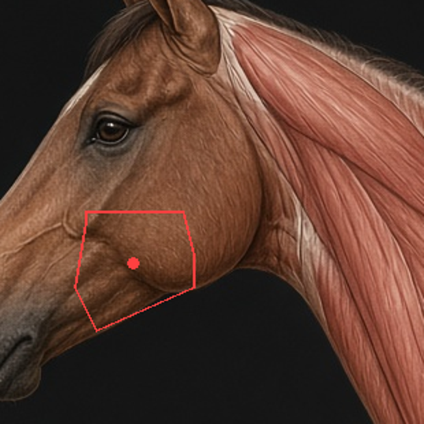
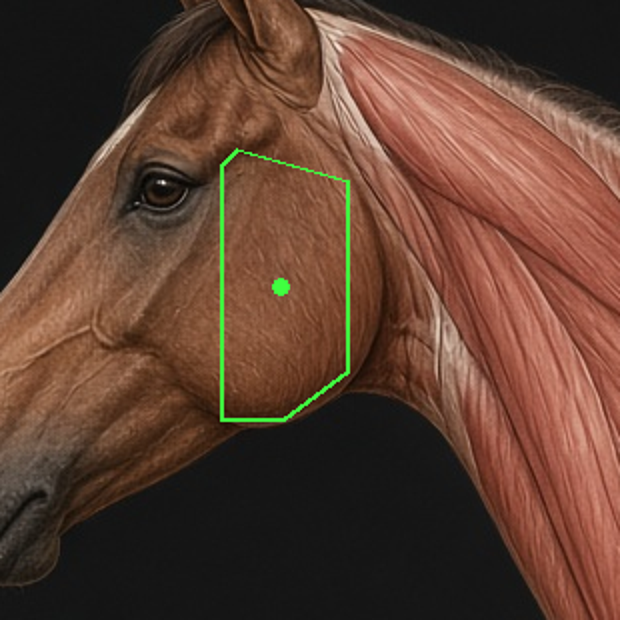
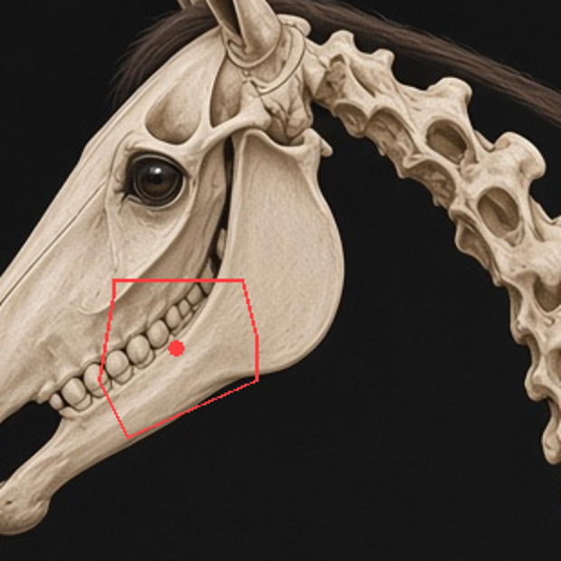
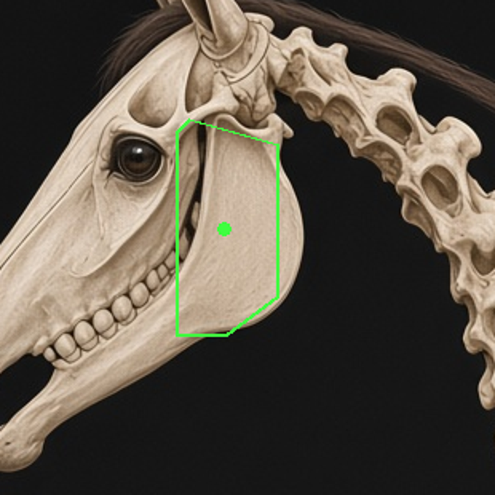
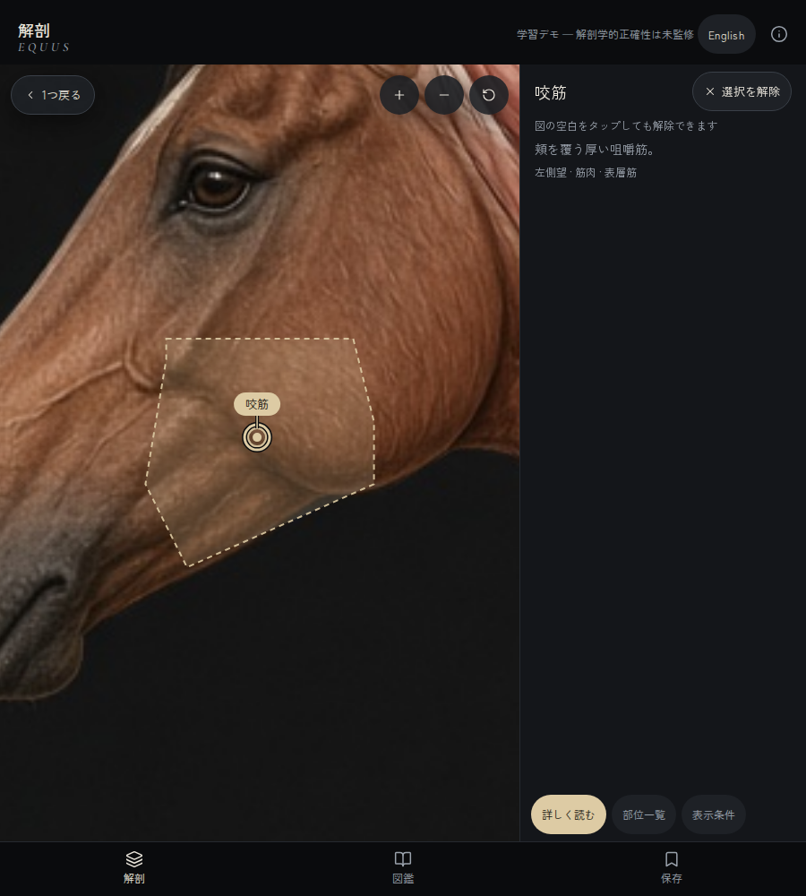
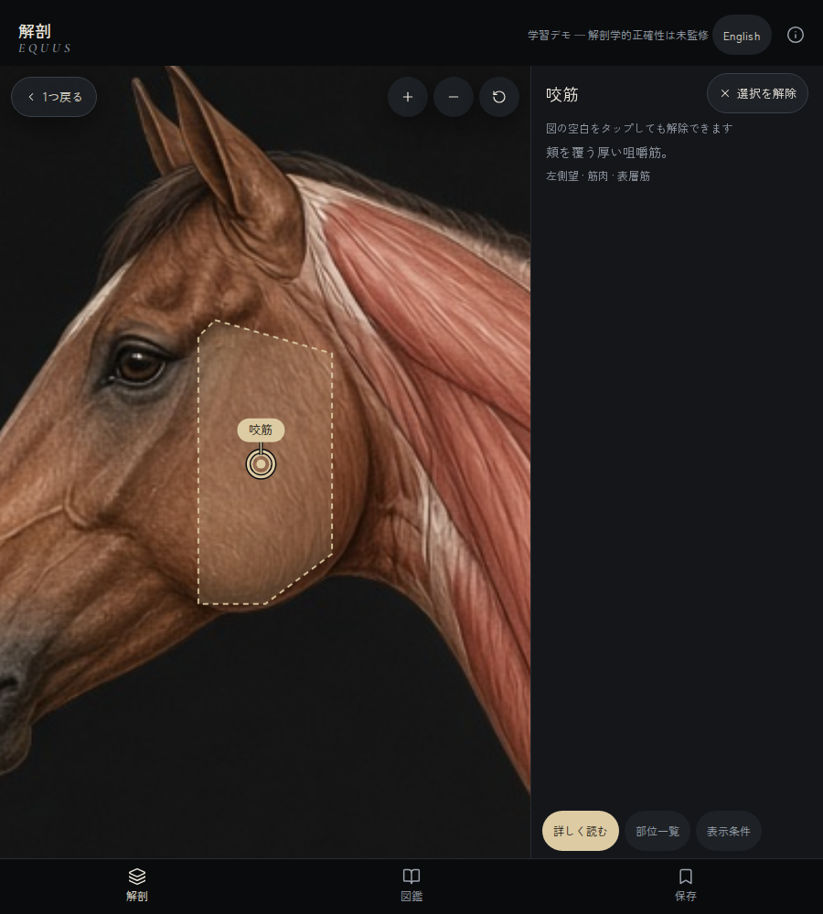
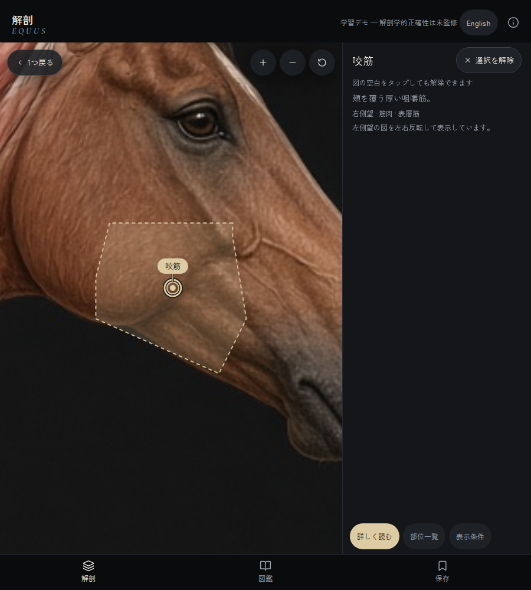
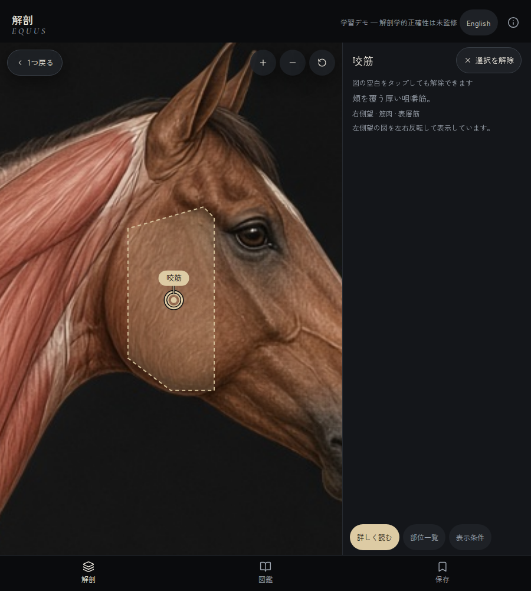
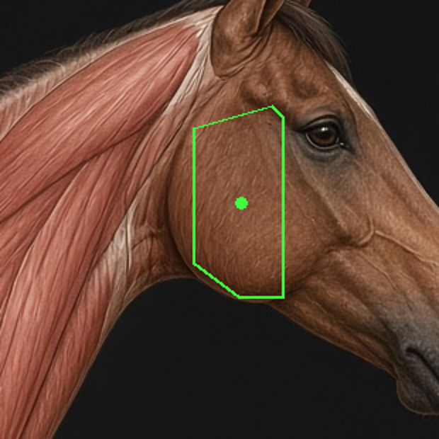

# 咬筋（muscle-masseter）を下顎枝〜下顎角へ移す — 証跡

- 日付: 2026-10-13
- 発端: 本人「咬筋の場所が違うと獣医から言われた。ちゃんとやって」（Equus 8db8 スレッド）
- 由来: 8db8 セッションの `devin/masseter-position-fix@91abae4` は push されないまま Devin 側ストレージで凍結された（remote に存在しないことを `git ls-remote` で確認）。
  スレッドに残った説明（x252–336・y158–316 に収める、labelAt≈(290,240)、正面図は main のまま、板状筋の吻側を詰める）を元に作り直した。91abae4 そのものの復元ではない。

## 何がおかしかったか

旧ポリゴン（x204–292, y244–332, 点 (247,282)）は臼歯の上の下顎体、つまり頬の前寄りに乗っていた。
咬筋は顔面稜・頬骨弓から下顎枝と下顎角に付く筋で、図では頬の後ろ半分の丸い膨らみに当たる。

骨格図 `skeleton_left.jpg`（筋肉図と同じ座標で描かれている。眼の位置は両方とも (240,190) 付近）から読んだランドマーク:

| ランドマーク | 座標 |
|---|---|
| 下顎枝の前縁（臼歯列の後端） | x≈255 |
| 下顎枝・下顎角の後縁 | x≈337（x≥340 は環椎・頸椎、間は黒い隙間） |
| 顔面稜〜顎関節の高さ | y≈160 |
| 下顎角の下縁 | y≈310 |

## 変更

- `scripts/derive-parts-left.ts` の咬筋 ROI を上の範囲に置き直し、`pnpm tsx scripts/derive-parts-left.ts` で `left.json` を再生成。
  結果は x260–324・y164–300、点 (290,233)。
- 板状筋（muscle-splenius）の前端を x≈296 から x≈338 へ下げた。旧 ROI は顎関節の後ろ、頭の上まで食い込んでいて、新しい咬筋と重なる。
- 他の 15 筋は再生成しても変わらない（main で同じスクリプトを回して差分ゼロを確認済み）。
- 正面図・後面図は触っていない。右側望は左のデータを反転して作るので自動で追従する。
- 腕頭筋（brachiocephalicus）は再生成後の輪郭が x≥396 で頭に届いておらず、今回は変えていない。

## 画像

| | 修正前 | 修正後 |
|---|---|---|
| 筋肉図（同じ切り抜き・同じ倍率） |  |  |
| 骨格図（同じ切り抜き・同じ倍率） |  |  |
| アプリ 左側望（900×1000、頭部→咬筋の点をタップ） |  |  |
| アプリ 右側望（同上） |  |  |

右側望の反転データを筋肉図の反転画像に重ねたもの: 

アプリの画面は頭部の部位の外接矩形に寄せて拡大するため、修正前後で寄り方が変わる。同じ範囲で比べるのは上の 2 行（データの重ね描き）を使う。
アプリ画面は Expo web の静的書き出し（`pnpm build`）を Playwright（Chromium）で撮ったもので、実機でもエミュレータでもない。

## 検証（ローカル、Node 22 / pnpm 10）

| コマンド | 結果 |
|---|---|
| `pnpm vitest run src/core/data/masseter-position.test.ts`（main のデータ） | 5 件中 4 件 FAIL（範囲外 204<250、点 247<270、旧位置が咬筋のまま ×2） |
| 同上（このブランチ） | 5 件 PASS |
| `pnpm test` | 7 回実行: 6 回は 36 files / 392 tests 全 PASS。1 回だけ失敗 1 件（テスト名は特定できず、他の 6 回では再現しなかった）。全 7 回とも 392 件の母数は同じ |
| `pnpm type-check` / `pnpm lint` | エラー 0 |
| `pnpm validate:coords` | OK（配置済み 119 件はすべて馬体の上） |
| `pnpm e2e`（ポート 3187 で配信、2 並列） | 107 PASS / 5 FAIL。FAIL は i18n・text-scale の 35〜58 秒タイムアウトで、2 spec を直列で再実行すると 13/13 PASS。#67 の「場所切替直後の連続タップ」は PASS（切替前の前肢の座標は修正後も咬筋の上に落ちる） |

## 残っていること

- 獣医の確認はまだ。これは図を実測したドラフト修正（`source: draft`）で、「獣医確認済み」ではない。
- 購入済みの参照アプリ（3D Horse Anatomy）とはまだ照合していない（端末ログインの判断待ち）。
- 実機での確認はしていない。
